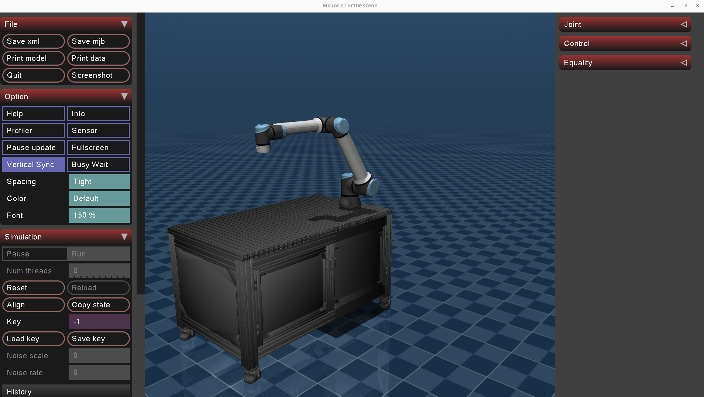

# UR_simulation

MuJoCo simulation of the Universal Robots UR10e and UR5e arms, controlled with ROS 2 Jazzy and running in a Docker container.

## Usage



### 1. Start the container

Run this on your PC, from the `UR_simulation` directory:

```bash
docker compose up -d
```

If the image has been built before, this only starts the container. Otherwise, it builds the image first and then starts the container.

Look up the name of the running container:

```bash
docker ps
```

### 2. Allow the container to open windows

Run this on your PC, **outside** the container, so that the MuJoCo viewer can be displayed:

```bash
xhost +local:docker
```

### 3. Enter the container

```bash
docker exec -it <container_name> zsh
# Example:
# docker exec -it ur_simulation-ur_mujoco-1 zsh
```

### 4. Build the ROS 2 workspace

Run these **inside** the container:

```bash
cd UR_simulation/ros2_ws
source /opt/ros/jazzy/setup.zsh
colcon build --symlink-install
```

### 5. Start the simulation

Make the start script executable, then run it from `ros2_ws`:

```bash
chmod +x /home/ubuntu/UR_simulation/ros2_ws/scripts/start_sim.zsh
./scripts/start_sim.zsh
```

This starts a [catmux](https://github.com/fmauch/catmux) session with three windows:

| Window | Name            | What it does                                                                                |
|--------|-----------------|---------------------------------------------------------------------------------------------|
| 1      | `action_server` | Runs the robot's action server and opens the MuJoCo simulation (UR10e by default).          |
| 2      | `move_robot`    | Runs an action client that moves the robot to a given joint configuration.                  |
| 3      | `shell`         | A plain terminal for further work.                                                          |

The session opens in the `move_robot` window. To switch windows, press `Ctrl+PageUp` / `Ctrl+PageDown` or click a window name in the status bar.

The robot is selected with the `robot` parameter in [`catmux/session.yaml`](catmux/session.yaml). Change `robot:=ur10e` to `robot:=ur5e` to simulate the UR5e.

The target joint configuration is set in [`joint_client.py`](ros2_ws/src/ur_simulation/ur_simulation/joint_client.py).

### 6. Shut down

1. Close every catmux window by typing `exit` in it. In the `action_server` window, press `Ctrl+C` first to stop the server.
2. Leave the container:

   ```bash
   exit
   ```

3. On your PC, from the `UR_simulation` directory, stop the container:

   ```bash
   docker compose stop
   ```
